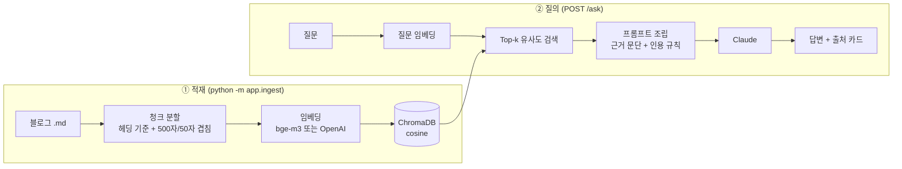

# Sonia Wiki — RAG 기반 개인 개발 위키

내 개발 블로그 글(마크다운)에 자연어로 질문하면, **관련 문단을 Vector DB에서 찾아 근거와 함께** 답해 주는 RAG 데모입니다.

> 데모 GIF 자리 — `docs/demo.gif`

## 아키텍처



## 기술 스택

| 영역 | 사용 기술 |
|---|---|
| API 서버 | Python, FastAPI |
| Vector DB | ChromaDB (로컬 영속 저장) |
| 임베딩 | `BAAI/bge-m3` (다국어, 로컬) / OpenAI `text-embedding-3-small` — 설정으로 교체 |
| LLM | Anthropic Claude |
| 프론트 | 바닐라 JS 채팅 UI (출처·유사도 표시) |

## 실행 방법

```bash
python -m venv .venv && source .venv/bin/activate
pip install -r requirements.txt
cp .env.example .env            # ANTHROPIC_API_KEY 입력

python -m app.ingest            # data/posts/*.md → ChromaDB
uvicorn app.main:app --reload   # http://localhost:8000
python -m eval.run_eval --k 3   # 검색 품질 평가
```

## 설계 결정

### 1. 청크 전략: 헤딩 우선 → 길이 분할
- 글을 먼저 마크다운 헤딩 단위로 자르고, 500자를 넘는 섹션만 50자씩 겹쳐 다시 자릅니다.
- **이유:** 고정 길이로만 자르면 한 청크에 서로 다른 주제가 섞여 검색 정확도가 떨어집니다.
- 각 청크 앞에 `[글 제목] 헤딩`을 붙여, 짧은 문단도 문맥을 잃지 않게 했습니다.

### 2. 임베딩 제공자 추상화
- 한국어 글이므로 다국어 모델이 필수. 비용 없는 로컬 `bge-m3`를 기본으로 하고, `EMBEDDING_PROVIDER=openai` 한 줄로 교체 가능합니다.
- Chroma 내장 임베딩 대신 **임베딩을 직접 계산해 넣어**, 모델을 바꿔도 저장 로직은 그대로입니다.

### 3. 환각 억제
- 시스템 프롬프트로 "context 안의 내용만 근거로, [번호] 인용, 없으면 모른다고 답하기"를 강제합니다.
- UI에 근거 문단과 유사도 점수를 함께 보여 줘 사용자가 답을 검증할 수 있습니다.

## 평가

`eval/questions.jsonl`의 질문마다 정답 문서가 Top-k 안에 들어오는지 측정합니다 (LLM 호출 없음 → 비용 0).

| 설정 | Hit@3 | MRR |
|---|---|---|
| bge-m3, chunk 500 | _측정 후 기입_ | |
| OpenAI small, chunk 500 | | |
| bge-m3, chunk 300 | | |

## 한계와 개선 계획
- **하이브리드 검색:** 고유명사·에러 코드는 키워드(BM25) 검색이 더 강함 → 벡터 + BM25 결합
- **리랭킹:** Top-20을 뽑은 뒤 cross-encoder로 재정렬
- **증분 적재:** 지금은 전체 재적재 → 파일 해시로 바뀐 글만 갱신
- **스트리밍 응답:** SSE로 답변을 실시간 표시

## 폴더 구조

```
app/
  config.py      # 환경 변수 설정
  chunking.py    # 마크다운 → 청크
  embeddings.py  # 임베딩 제공자 (local / openai)
  store.py       # ChromaDB 저장·검색
  ingest.py      # 적재 스크립트
  rag.py         # 프롬프트 조립 + Claude 호출
  main.py        # FastAPI
web/index.html   # 채팅 UI
eval/            # 검색 품질 평가
data/posts/      # 위키 원본 마크다운
```
