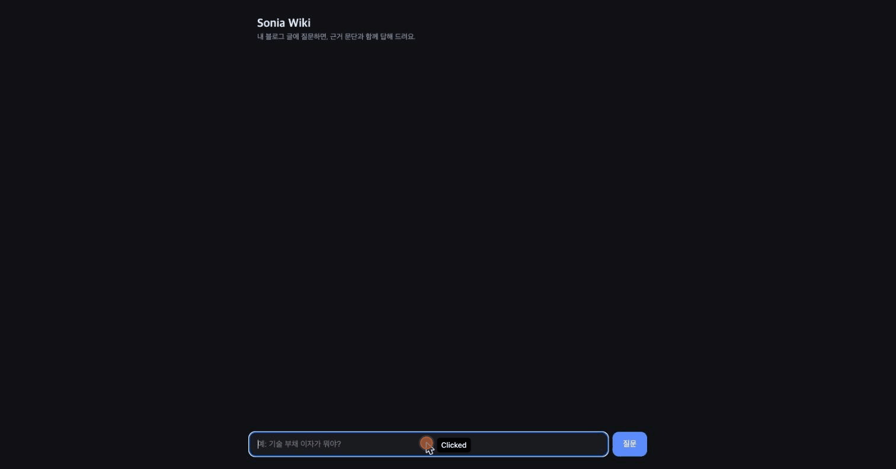
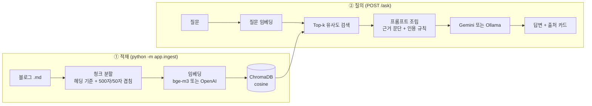
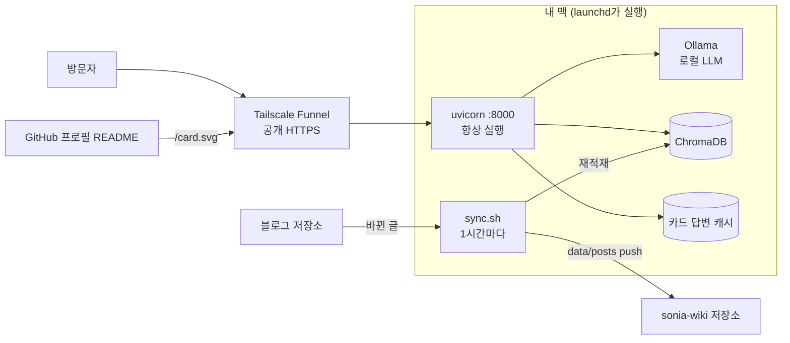

# Sonia Wiki — RAG 기반 개인 개발 위키

내 개발 블로그 글(마크다운)에 자연어로 질문하면, **관련 문단을 Vector DB에서 찾아 근거와 함께** 답해 주는 RAG 데모입니다.

- 데이터: 제 블로그 [Sonia.dev](https://ckdtjs505.github.io)에 공개한 글 56개 (`data/posts/`, 2026-11-19 기준 · 1시간마다 자동 동기화)
- 답변의 출처 카드를 누르면 해당 블로그 글로 이동합니다.
- **라이브 데모:** [changsun-macbookair.tail55c391.ts.net](https://changsun-macbookair.tail55c391.ts.net) (제 맥에서 돌아가므로 맥이 꺼져 있으면 열리지 않습니다)



## 아키텍처



## 운영 구조

서버는 클라우드가 아니라 제 맥 한 대에서 돌아갑니다. 띄우고 갱신하는 일은 모두 launchd가 합니다.



| 구성 | 하는 일 |
|---|---|
| `dev.sonia.wiki` (launchd) | `uvicorn app.main:app`을 `127.0.0.1:8000`에 항상 띄움 |
| Tailscale Funnel | `127.0.0.1:8000`을 공개 HTTPS 주소로 노출 (포트포워딩·클라우드 없음) |
| `dev.sonia.wiki.sync` (launchd) | 1시간마다 `sync.sh` 실행 → 블로그에서 바뀐 글이 있으면 재적재·서버 재시작·커밋 |
| Ollama | `LLM_PROVIDER=ollama`일 때 맥에서 답변 생성 (API 비용 없음) |
| `/card.svg?q=` | 질문에 대한 답을 SVG 카드로 그려 [GitHub 프로필](https://github.com/ckdtjs505) README에 이미지로 표시 |

**API**

| 경로 | 설명 |
|---|---|
| `GET /` | 채팅 UI (`?q=질문`이면 바로 질문) |
| `POST /ask` | 질문 → 답변 + 출처 (IP당 분당 5회, 전체 분당 20회 제한) |
| `GET /search?q=` | LLM 없이 검색 결과만 (평가·디버깅용) |
| `GET /card.svg?q=` | README용 답변 카드. 답은 `.cache/cards.json`에 캐시하고, GitHub 이미지 프록시가 1시간 캐시 |
| `GET /health` | 상태 확인 |

> `sync.sh`는 동기화할 때 카드 캐시를 비우고, 프로필 README에 있는 질문의 답을 새 글 기준으로 다시 만듭니다.
>
> 처음 보는 질문의 카드는 LLM 답변에 15~30초가 걸려 GitHub 이미지 프록시가 기다려 주지 않습니다. 프로필에 새 질문을 넣기 전에 `curl --get --data-urlencode "q=질문" localhost:8000/card.svg`로 미리 만들어 둡니다.

## 기술 스택

| 영역 | 사용 기술 |
|---|---|
| API 서버 | Python, FastAPI |
| Vector DB | ChromaDB (로컬 영속 저장) |
| 임베딩 | `BAAI/bge-m3` (다국어, 로컬) / OpenAI `text-embedding-3-small` — 설정으로 교체 |
| LLM | Google Gemini / Ollama 로컬 모델 (`LLM_PROVIDER`로 교체) |
| 프론트 | 바닐라 JS 채팅 UI (출처·유사도 표시, [sonia-ui](https://github.com/ckdtjs505/sonia-ui) 테마) |
| 운영 | 맥 + launchd + Tailscale Funnel |

## 실행 방법

```bash
python3.12 -m venv .venv && source .venv/bin/activate
pip install -r requirements.txt
cp .env.example .env            # GEMINI_API_KEY 입력 (https://aistudio.google.com/apikey, 무료 등급 가능)

python -m app.ingest            # data/posts/*.md → ChromaDB
uvicorn app.main:app --reload   # http://localhost:8000
python -m eval.run_eval --k 3   # 검색 품질 평가
```

### 블로그 글 자동 동기화

`./sync.sh`는 블로그 저장소의 `_posts/`를 받아 `data/posts/`에 맞춥니다. 각 글에는 원문 링크 `url:`을 붙이고, 블로그에서 지운 글은 여기서도 지웁니다.
바뀐 글이 있으면 재적재, 서버 재시작, `data/posts` 커밋·push까지 하고, 없으면 아무것도 하지 않습니다.

- 서버가 맥 로컬(`127.0.0.1`)에서 돌아 GitHub 웹훅이 닿지 않으므로, launchd(`~/Library/LaunchAgents/dev.sonia.wiki.sync.plist`)가 1시간마다 실행합니다.
- 로그: `~/Library/Logs/sonia-wiki-sync.log`


> 평가(`eval.run_eval`)와 검색(`GET /search?q=`)은 LLM을 부르지 않아 API 키 없이도 재현할 수 있습니다.

## 설계 결정

### 1. 청크 전략: 헤딩 우선 → 길이 분할
- 글을 먼저 마크다운 헤딩 단위로 자르고, 500자를 넘는 섹션만 50자씩 겹쳐 다시 자릅니다.
- **이유:** 고정 길이로만 자르면 한 청크에 서로 다른 주제가 섞여 검색 정확도가 떨어집니다.
- 각 청크 앞에 `[글 제목] 헤딩`을 붙여, 짧은 문단도 문맥을 잃지 않게 했습니다.

### 2. 임베딩 제공자 추상화
- 한국어 글이므로 다국어 모델이 필수. 비용 없는 로컬 `bge-m3`를 기본으로 하고, `EMBEDDING_PROVIDER=openai` 한 줄로 교체 가능합니다.
- Chroma 내장 임베딩 대신 **임베딩을 직접 계산해 넣어**, 모델을 바꿔도 저장 로직은 그대로입니다.

### 3. 환각 억제
- 시스템 프롬프트로 "context 안의 내용만 근거로, [번호] 인용, 없으면 모른다고 답하기"를 강제합니다.
- UI에 근거 문단과 유사도 점수를 함께 보여 줘 사용자가 답을 검증할 수 있습니다.

## 평가

`eval/questions.jsonl`의 질문마다 정답 문서가 Top-k 안에 들어오는지 측정합니다 (LLM 호출 없음 → 비용 0).

질문 14개, 측정 당시 문서 45개(청크 365개) 기준입니다. 질문은 글 제목을 그대로 쓰지 않고 다른 말로 바꿔 물었습니다.

| 설정 | 청크 수 | Hit@1 | Hit@3 | MRR@3 |
|---|---|---|---|---|
| bge-m3, chunk 500 / overlap 50 (기본값) | 365 | 86% (12/14) | 100% (14/14) | 0.917 |
| bge-m3, chunk 300 / overlap 30 | 505 | 86% (12/14) | 100% (14/14) | 0.929 |

- **1위를 놓친 2건은 두 설정에서 같았습니다.** 모두 주제가 겹치는 글에 밀렸습니다.
  - 클로저 질문 → '렉시컬 환경' 글이 1위, 클로저 글은 2위
  - 프로토타입 체인 질문 → '객체' 글이 1위, 프로토타입 글은 3위(500) / 2위(300)
- **청크를 300으로 줄여도 거의 같았습니다.** MRR 차이는 질문 1개의 순위가 한 칸 오른 것뿐인데, 청크는 38% 늘어납니다. 그래서 기본값은 500으로 두었습니다.
- **남은 문제는 청크 크기가 아니라 비슷한 주제끼리의 구분입니다.** 다음에 할 일은 리랭커(예: bge-reranker)로 상위 결과의 순서를 다시 매기는 것입니다.
- 질문이 14개뿐이라 1문항이 약 7%p를 움직입니다. 질문을 늘릴수록 숫자를 더 믿을 수 있습니다.

## 한계와 개선 계획
- **하이브리드 검색:** 고유명사·에러 코드는 키워드(BM25) 검색이 더 강함 → 벡터 + BM25 결합
- **리랭킹:** Top-20을 뽑은 뒤 cross-encoder로 재정렬
- **증분 적재:** 지금은 글이 하나만 바뀌어도 동기화 때 전체 재적재(약 1분) → 파일 해시로 바뀐 글만 갱신
- **스트리밍 응답:** SSE로 답변을 실시간 표시

## 폴더 구조

```
app/
  config.py      # 환경 변수 설정
  chunking.py    # 마크다운 → 청크
  embeddings.py  # 임베딩 제공자 (local / openai)
  store.py       # ChromaDB 저장·검색
  ingest.py      # 적재 스크립트
  rag.py         # 프롬프트 조립 + Gemini 또는 Ollama 호출
  main.py        # FastAPI (/ask, /search, /card.svg)
web/index.html   # 채팅 UI
eval/            # 검색 품질 평가
data/posts/      # 위키 원본 마크다운 (sync.sh가 블로그에서 동기화)
sync.sh          # 블로그 → data/posts 동기화 + 재적재
.cache/          # (git 제외) 블로그 clone, 카드 답변 캐시
```

## 라이선스

코드는 [MIT](LICENSE)입니다. `data/posts/`의 블로그 글은 저작권이 저에게 있으며 재사용을 허락하지 않습니다.
