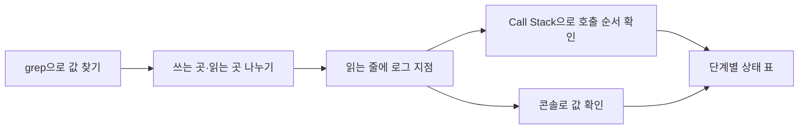

## TL;DR

- 배포 전날 AI가 짠 음소거 자동재생 코드를 다시 읽었는데, 줄마다 "왜 들어갔냐"고 물어 답을 들어도 이해가 되지 않았다.
- AI에게 "코드 이해력을 어떻게 키우냐"고 묻자 돌아온 답은 "직접 보세요"였다.
- 크롬 DevTools의 로그 지점(Logpoint)으로 소스를 고치지 않고 값 하나를 찍으며 흐름을 따라가자, AI가 쓴 코드가 눈에 들어오고 불필요한 코드(slop)도 보였다.
- 코드를 짜는 속도는 AI가 올려 줬고, 이제 병목은 그 코드를 이해하는 내 속도였다.

## AI가 짠 코드를 설명 들어도 이해하지 못하는 이유는 무엇일까?

설명은 남의 머릿속 실행 결과이고, 내 머릿속에서는 아직 한 번도 실행되지 않았기 때문이다.
글로 된 답은 맞는 말이어도, 그 값이 언제 어떤 상태인지 직접 본 적이 없으면 다음 질문이 계속 생긴다.

이번 코드는 광고로 들어온 사용자에게 음소거 자동재생을 거는 기능이었다.
기능 자체는 [AI와 코딩 대결에서 20줄짜리 내 코드가 진 이유](/posts/ai-coding-battle-muted-autoplay)에서 다룬 것과 같다.
배포 전날, 실제로 나갈 코드를 처음부터 다시 읽었다.

읽다 보니 이해되지 않는 줄이 많았다.
한 줄씩 Claude에게 물었다.

- 이 플래그는 왜 따로 두나?
- 이 setter는 왜 두 군데에서 막나?
- 이 값은 왜 저장하지 않나?

대답은 매번 친절했고 틀린 말도 아니었다.
그런데 다음 줄로 넘어가면 앞의 설명이 다시 흐려졌다.
이때 처음으로 "코드를 쓰는 건 AI가 빨라졌는데, 이걸 이해하는 내가 병목이구나"라는 생각이 들었다.

최근 이런 상태를 이해 부채(Comprehension Debt)라고 부른다.
팀이 내보내는 코드의 양과 사람이 실제로 이해한 코드의 양 사이의 차이를 말한다.
기술 부채와 달리 코드가 깔끔해 보여서 쌓이는 줄 모른다는 점이 더 위험하다.
기술 부채 자체는 [기술 부채(Technical Debt)의 개념과 메커니즘](/posts/technical_debt)에 정리해 두었다.

## 코드 이해력을 키우려면 AI에게 무엇을 물어야 할까?

수십 번을 묻다가 질문을 바꿨다.
"진짜 이해가 안 가. 코드 이해력은 어떻게 키우지?"

답은 생각보다 단순했다.
머리로 실행하지 말고, 브라우저에서 멈춰서 값을 직접 보라는 것이었다.
정리하면 세 가지였다.

1. 함수가 아니라 값 하나를 따라간다. `grep`으로 그 값을 쓰는 곳과 읽는 곳을 나눈다.
2. 읽는 줄에 중단점(Breakpoint)이나 로그 지점을 걸고 실제 실행 순간의 값을 본다.
3. 단계마다 값 2~3개의 상태를 표로 적는다. "저장되나?" 같은 질문은 표가 답한다.

백문이 불여일견이었다.
"왜 이렇게 됐어?"라는 질문은 설명을 끝없이 불렀지만, "지금 이 값이 뭐야?"라는 질문은 화면 한 번으로 끝났다.

## 크롬 로그 지점(Logpoint)은 무엇이고 어떻게 거나?

로그 지점은 소스를 고치지 않고 특정 줄이 실행될 때 콘솔에 값을 찍는 크롬 DevTools 기능이다.
중단점처럼 실행을 멈추지 않으니 흐름을 끊지 않고 값만 본다.


거는 방법은 이렇다.

1. Sources 패널에서 파일을 연다. `Cmd+P`로 파일 이름, `Cmd+Option+F`로 변수 이름을 찾는다.
2. 보고 싶은 줄 번호를 우클릭하고 "로그 지점 추가(Add logpoint)"를 누른다.
3. 찍을 표현식을 적는다. 예: `'muted', muted, 'adLanding', isAdLandingMuted`
4. 페이지를 다시 동작시키면 그 줄을 지날 때마다 콘솔에 값이 찍힌다.

개발을 오래 했지만 이 메뉴가 있는 줄은 처음 알았다.
지금까지 값 하나 보려고 너무 어렵게 하고 있었다.
로그 지점은 소스에 `console.log`를 넣고 다시 빌드할 필요가 없고, 지우는 걸 잊어 커밋에 섞일 일도 없다.

같은 메뉴의 조건부 중단점(Conditional breakpoint)은 조건이 참일 때만 멈춘다.
흐름 전체를 보고 싶으면 로그 지점, 특정 상황 하나만 잡고 싶으면 조건부 중단점을 쓴다.

## 값 하나를 따라가면 무엇이 보이나?

이번에 고른 값은 광고 유입 음소거 플래그 `isAdLandingMuted` 하나였다.
먼저 `grep`으로 쓰는 곳과 읽는 곳을 나눴다.

```bash
grep -rn "isAdLandingMuted" src
```

쓰는 곳은 3곳(광고 유입 음소거 함수, 플레이어 setter, 초기화), 읽는 곳은 1곳(스트리머의 `muted` setter)이었다.
읽는 곳이 하나뿐이니 그 줄에만 로그 지점을 걸면 됐다.

그다음 광고 유입 URL로 들어가 음소거를 풀어 보며 값을 찍고 표로 옮겼다.

| 단계 | `muted` | `isAdLandingMuted` | `localStorage.muted` |
|---|---|---|---|
| 입장 | false | false | 0 |
| 광고 유입 음소거 | true | true | 0 (저장 안 됨) |
| 재생 시작 | true | true | 0 |
| 사용자가 음소거 해제 | false | false | 0 (이제 저장) |

표를 만들고 나서야 정책이 한 문장으로 정리됐다.
"사용자가 UI로 바꾼 값만 저장한다."
AI가 여러 번 설명해 준 내용과 같았지만, 이번에는 내가 본 값으로 이해했다.

중단점에서 멈췄을 때는 Call Stack 패널도 봤다.
글로 정리해 둔 입장 단계의 함수 순서가 그대로 쌓여 있어서, "누가 이 setter를 불렀나"를 따로 추적할 필요가 없었다.



## 이해하고 나니 무엇이 달라졌나?

처음부터 100% 이해되지는 않았다.
값을 찍어 놓고도 "이게 왜 이렇게 됨?", "이건 왜 추가함?", "어떤 상황 때문이야?"를 계속 물었다.
달라진 점은 질문이 막연한 "이해가 안 가"가 아니라 눈앞의 값과 줄을 가리키게 됐다는 것이다.

그렇게 붙들고 있다 보니 늦었지만 AI가 쓴 코드 전체가 눈에 들어오기 시작했다.
그리고 이해가 되자 필요 없는 코드도 보였다.
설명은 그럴듯하지만 실제 흐름에서는 필요 없는 코드(slop)를 찾아 지웠다.
이해하지 못했을 때는 "AI가 넣었으니 이유가 있겠지" 하고 남겨 뒀을 코드다.

다음 날 배포는 정한 순서대로 나갔고 특이사항은 없었다.

## 검토한 대안

### 1안: AI 설명을 더 자세히 받기 (버림)

질문을 더 쪼개고 더 긴 설명을 받았다.
설명이 길어질수록 읽을 글만 늘었고, 내 머릿속 실행은 그대로였다.

### 2안: 소스에 `console.log` 넣기 (버림)

익숙한 방법이지만 값 하나 볼 때마다 수정·빌드·정리가 필요하다.

### 3안: 로그 지점과 상태 표 (선택)

소스를 건드리지 않고 실제 값을 본다.
표로 남기니 다음에 같은 코드를 볼 때도 다시 쓸 수 있다.

## AI 시대에 좋은 개발자는 무엇을 이해해야 할까?

AI가 쓴 코드를 이해하고, 한 걸음 더 나아가 그 코드가 왜 필요했는지 상황까지 이해하는 개발자라고 생각한다.
"이 줄이 무엇을 하나"는 AI가 바로 설명해 준다.
"이 줄이 없으면 어떤 사용자에게 무슨 일이 생기나"는 직접 값을 보고 상황을 겪어야 내 것이 된다.

그 상황을 물어보면 AI는 친절히 알려 준다.
다만 그 답을 확인하는 눈은 내가 길러야 한다.
코드를 짜는 속도가 빨라진 만큼, 이해하는 속도를 올리는 공부는 멈추지 말아야겠다.

## 참고

- [Pause your code with breakpoints - Chrome DevTools](https://developer.chrome.com/docs/devtools/javascript/breakpoints)
- [Comprehension Debt - Addy Osmani](https://addyosmani.com/blog/comprehension-debt/)
- [Comprehension Debt: The Hidden Cost of AI-Generated Code - O'Reilly](https://www.oreilly.com/radar/comprehension-debt-the-hidden-cost-of-ai-generated-code/)
