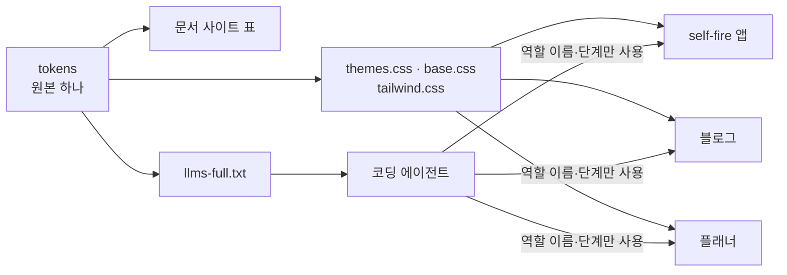

## TL;DR

- 앱(self-fire), 블로그, 플래너가 강조색 세 개(주황 `#FF7A3D`, 파랑 `#58A6FF`, 초록 `#2F5D50`)와 변수 이름 세 벌을 따로 쓰고 있었다.
- self-fire의 테마를 떼어 내 디자인 시스템 sonia-ui를 만들었다. 첫 커밋부터 AI용 문서 커밋까지 약 1시간, 테마 9종, 입구 7개, 문서 12쪽, `sn-*` 클래스 13개다.
- 사람보다 AI가 먼저 읽는다고 보고 `llms.txt`, `llms-full.txt`, `AGENTS.md`, Claude Code 스킬을 같이 만들었다. 모든 값은 토큰 한 곳에서 생성된다.
- 다음 날 문서 사이트 랜딩을 impeccable로 다듬어 디자인 평가를 20점에서 22점(32점 만점)으로, 대비 기준 미달 테마를 4개에서 0개로 줄였다.

## 왜 AI가 만든 화면은 다 비슷해 보일까?

모델은 지시가 없으면 학습 데이터에서 가장 흔한 모양을 고른다. 그래서 같은 글꼴, 보라색 그라데이션, 둥근 카드 세 개 같은 화면이 반복된다는 분석이 최근 계속 나오고 있다([Built In](https://builtin.com/articles/ai-design-slop-era)). 이 글들이 공통으로 내놓는 처방은 화면을 만들기 전에 디자인 시스템을 먼저 고정하라는 것이다.

내 프로젝트들은 반대 방향의 문제를 갖고 있었다. 프로젝트 하나 안에서는 일관됐지만, 프로젝트끼리는 서로 다른 사람이 만든 것처럼 보였다. sonia-ui를 붙이기 직전 세 프로젝트의 강조색과 변수 이름은 이랬다.

| 프로젝트 | 강조색 | 변수 이름 |
|---|---|---|
| self-fire (Expo 앱) | `#FF7A3D` 주황 | `primary`, `background`, `foreground` |
| 블로그 | `#58A6FF` 파랑 | `--accent-color`, `--bg-color`, `--text-primary` |
| 플래너 | `#2F5D50` 초록 | `--accent`, `--bg`, `--ink` |

같은 "강조색"을 세 이름으로 부르고 있었다. 이 상태로 AI에게 "다른 프로젝트처럼 만들어 줘"라고 하면, AI는 어느 이름과 어느 값을 따라야 할지 알 수 없다.

## 디자인 시스템을 AI가 쓰게 하려면 무엇을 줘야 하나?

AI에게는 "어떤 값을 써도 되는지"를 닫힌 목록으로 주는 게 핵심이다. 나는 세 가지 규칙을 정했다.

1. 색은 `#ff7a3d` 같은 값이 아니라 `primary`, `surface` 같은 **역할 이름**으로만 쓴다.
2. 간격과 글자 크기는 `p-lg`, `text-title` 같은 **이름 단계**로만 쓴다.
3. 각 프로젝트에서 값을 덮어쓰지 않는다. 바꾸고 싶으면 sonia-ui에서 바꾼다.

세 프로젝트의 색은 버리지 않고 테마로 옮겼다. self-fire의 주황은 `dark` 테마의 `primary`, 블로그의 파랑은 `sonia` 테마의 `primary`가 됐다. 사용하는 쪽 코드는 이렇게 짧아진다.

```css
/* app.css */
@import "tailwindcss";
@import "sonia-ui/tailwind.css";
```

```html
<html data-theme="dark">
<div class="rounded-md bg-surface p-lg">
  <h1 class="text-title">안녕</h1>
</div>
```

그리고 AI가 이 규칙을 찾아 읽을 수 있게 입구를 따로 만들었다.

| 파일 | 누가 읽나 | 역할 |
|---|---|---|
| `llms.txt` (19줄) | 웹을 읽는 AI | 짧은 색인 |
| `llms-full.txt` (194줄) | 웹을 읽는 AI | 토큰·컴포넌트 전체 |
| `AGENTS.md` | 저장소를 연 코딩 에이전트 | 규칙과 금지 사항 |
| Claude Code 스킬 `sonia-ui` | 다른 프로젝트의 Claude Code | "테마 붙여줘" 요청 시 설치·적용 순서 |

요즘 코딩 에이전트용 지시 파일은 `AGENTS.md`(행동·맥락), `SKILL.md`(반복 작업), `DESIGN.md`(시각 정체성) 세 층으로 나뉘는 흐름이다([DEV Community](https://dev.to/aws-builders/agentsmd-skillmd-designmd-how-ai-instructions-split-into-three-layers-d0g)). 만들 때는 이 정리를 몰랐지만, 결과적으로 같은 모양이 됐다. 큰 디자인 시스템도 비슷하게 한다. Nord는 짧은 `llms.txt` 색인과 전체 파일을 나눠 두고([Nord](https://nordhealth.design/ai/llms-txt)), Cloudscape는 문서 페이지마다 마크다운판을 둔다([Cloudscape](https://cloudscape.design/get-started/for-developers/ai-tools-support/)).

## 값 하나를 고치면 문서와 AI 문서까지 같이 바뀌게 하려면?

토큰을 원본 하나로 두고, CSS·문서 표·`llms-full.txt`를 전부 거기서 생성하면 된다. 손으로 쓴 문서가 하나라도 있으면 AI는 결국 낡은 값을 읽는다.



이 구조 덕분에 테마 색 하나를 바꾸면 화면, 문서, AI가 읽는 설명이 한 번에 맞춰진다. 이 블로그 상단의 테마 선택도 목록을 직접 갖고 있지 않고 `sonia-ui/tokens`의 `themeList`를 그대로 읽는다.

배포도 같은 원칙으로 맞췄다. 처음에는 고칠 때마다 버전 태그를 손으로 올려야 CDN `@1` 주소가 따라왔다. 다음 날 `src/`가 바뀐 푸시마다 태그를 자동으로 올리고 jsDelivr `@1` 캐시를 비우는 GitHub Action을 붙여, 손으로 하는 단계를 없앴다.

## 기존 프로젝트에 붙여도 화면이 깨지지 않게 하려면?

디자인 시스템 CSS를 `@layer` 안에 넣으면 된다. 캐스케이드 레이어(Cascade Layers)에 들어간 규칙은 레이어 밖에 직접 쓴 CSS에 항상 진다. 그래서 sonia-ui를 import해도 프로젝트가 원래 쓰던 스타일이 그대로 이기고, 한 화면씩 천천히 옮길 수 있다.

```js
import "sonia-ui/base.css"; // @layer sonia 안이라 내 CSS가 항상 이긴다
```

플래너는 이 방식으로 기존 변수 이름을 지우지 않고 값만 sonia-ui에 연결했다. `--bg: var(--color-background)`처럼 한 줄씩 이어 주니, 화면 코드는 그대로 두고 색만 테마를 따라가게 됐다.

## 랜딩은 AI가 고쳤는데 왜 점수가 멈췄을까?

다음 날 문서 사이트 랜딩을 impeccable 스킬로 다듬었다. 랜딩의 1차 독자를 사람이 아니라 AI로 정하고, 약 50분 동안 커밋 12개를 main에 바로 올렸다.

| 항목 | 전 | 후 |
|---|---|---|
| 디자인 평가 (32점 만점) | 20 | 21 → 22 → 21 |
| 감지기가 찾은 실제 문제 | 6 | 0 |
| 대비 기준(AA) 미달 테마 | 4 | 0 |

점수는 21~22에서 멈췄다. 한 줄씩 다듬는 방식으로는 "같은 말이 반복된다", "모든 섹션이 같은 무게다" 같은 구조 문제가 풀리지 않았기 때문이다. 중복을 없애려고 "위의 한 줄을 보세요"처럼 다른 곳을 가리키자, 읽는 사람이 기억해야 할 게 늘어 점수가 오히려 내려갔다. 그래서 마지막 커밋에서는 문장을 고치지 않고 시작 섹션의 구조를 바꿨다. AI로 시작하는 길을 전체 폭으로 올리고, 직접 설치하는 길은 그 아래 3열로 나눴다.

감지기 오탐에도 배울 점이 있었다. 대부분 `DESIGN.md`에 라이트 테마 값만 적어 두고 페이지 기본은 다크였기 때문에 생겼다. AI가 읽는 문서가 실제 화면과 다르면 AI의 판단도 틀린다. 이렇게 고치면서 정한 규칙은 두 개다.

- 강조색 `primary`는 한 화면에 하나만 쓴다. 선택된 테마 칩도 `primary`면 첫 화면에 강조가 둘이 되니, 선택 상태는 `soft`로 바꿨다.
- 테마 색은 핵심 대비 4.5:1 아래로 내리지 않는다.

같은 스킬을 다른 사이트에 써서 디자인 대신 버그를 잡은 이야기는 [impeccable 스킬 후기](/posts/impeccable-skill-review)에 적었다.

## 검토한 대안

### 1안: 프로젝트마다 Tailwind 설정만 복사하기 (버림)

가장 빠르지만 복사본이 프로젝트 수만큼 생긴다. 한 곳에서 색을 바꾸면 나머지는 낡고, AI는 어느 쪽이 맞는지 알 수 없다. 강조색이 셋이 된 것도 결국 프로젝트마다 따로 정한 결과였다.

### 2안: 비공개 저장소로 두기 (버림)

GitHub 무료 요금제는 비공개 저장소로 Pages를 쓸 수 없어 문서 사이트를 띄울 수 없었다. 공개로 바꾸자 앱 빌드(EAS)가 비공개 패키지를 못 받던 문제도 같이 풀렸다.

## 결과 / 회고

- 이제 모든 디자인은 sonia-ui에서 만들고 각 프로젝트는 가져다 쓴다. 지금은 self-fire, 블로그, 플래너, 문서 사이트 4곳이 같은 토큰을 쓴다.
- 새 프로젝트에서는 Claude Code에 "sonia-ui로 만들어줘" 한 줄이면 스킬이 설치와 적용 순서를 따라간다.
- 남은 프로젝트는 5개다. 작은 것부터 옮기고, Tailwind v3를 쓰는 프로젝트는 v4로 올리면서 같이 옮긴다.
- AI가 만든 화면이 비슷해 보이는 문제는 AI를 탓하기보다, AI에게 고를 수 있는 값을 닫아 주지 않은 쪽의 문제에 가깝다. 강조색이 셋이던 내 프로젝트들이 그 증거였다.

## 참고

- [AI Makes Bad Design Look Good Enough - Built In](https://builtin.com/articles/ai-design-slop-era)
- [AGENTS.md, SKILL.md, DESIGN.md: How AI Instructions Split into Three Layers - DEV Community](https://dev.to/aws-builders/agentsmd-skillmd-designmd-how-ai-instructions-split-into-three-layers-d0g)
- [llms.txt - Nord Design System](https://nordhealth.design/ai/llms-txt)
- [AI tools support - Cloudscape](https://cloudscape.design/get-started/for-developers/ai-tools-support/)
- [Cascade Layers - MDN](https://developer.mozilla.org/en-US/docs/Web/CSS/@layer)
- [sonia-ui 문서](https://ckdtjs505.github.io/sonia-ui/docs/installation.html)
